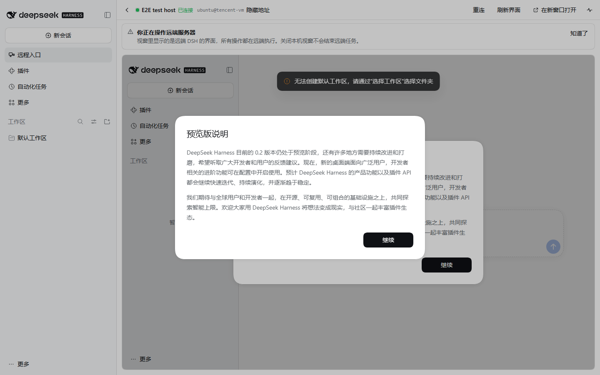

# dsh-remote-go

> 在本地 DeepSeek Harness（DSH）里，通过 SSH 整页使用服务器上的 DSH。本地只负责连接、入口与状态。

[](https://github.com/Solaris136/dsh-remote-go/actions/workflows/ci.yml)
[](https://github.com/Solaris136/dsh-remote-go/actions/workflows/codeql.yml)
[](LICENSE)
[](#版本与兼容)
[](#版本与兼容)

**English** — `dsh-remote-go` is a [DeepSeek Harness](https://github.com/deepseek-ai) plugin that opens a **remote** DSH
inside a full-page panel of your local DSH over SSH. The remote DSH web UI is embedded from the loopback tunnel
(same-site iframe); hosts are managed in **Settings → Remote hosts**. The local half only does four things:
host inventory, SSH connection plus tunnel, panel hosting, and connection status/diagnostics. Current version:
**0.1.0** (a **thin client**, not yet published to npm; no remote-side components are installed beyond vanilla DSH).

## 目录

- [它是什么](#它是什么)
- [当前状态与验收证据](#当前状态与验收证据)
- [功能](#功能)
- [安装](#安装)
- [快速开始](#快速开始)
- [远端自举分级](#远端自举分级)
- [架构与关键决策](#架构与关键决策)
- [安全](#安全)
- [版本与兼容](#版本与兼容)
- [开发与测试](#开发与测试)
- [CI 与发布](#ci-与发布)
- [已知限制](#已知限制)
- [参与贡献](#参与贡献)
- [License](#license)

## 文档

| 文档 | 内容 |
|---|---|
| [docs/design.md](docs/design.md) | 产品与协议设计（含 V1.0 范围、自举分级、威胁模型） |
| [docs/implementation.md](docs/implementation.md) | 模块划分与实现要点 |
| [docs/api.md](docs/api.md) | 本地 Host 插件 HTTP API 契约 |
| [docs/publish.md](docs/publish.md) | 发布到 npm / 插件市场的流程与检查清单 |
| [docs/session-design.md](docs/session-design.md) | 「完全会话」设计：远端会话镜像成本地原生会话（能力分级、数据模型、事件流、失败模式） |
| [e2e/remote/README.md](e2e/remote/README.md) | 远端测试环境的自举与复跑步骤 |
| [docs/research-competitors.md](docs/research-competitors.md) | 同类项目调研 |
| [docs/research-dsh-remote-window.md](docs/research-dsh-remote-window.md) | 相近实现调研（dsh-remote-window） |

## 它是什么

- 一个 DSH 插件：主机在 **设置 → 远程主机** 里配置，打开后在**全局面板**里整页使用远端 DSH（**不占用侧边栏入口**）。
- 面板里是一整页**远端 DSH 自己的 Web 界面**（同站 loopback iframe）。会话、审批、文件、终端、插件、凭据、日志都由远端 DSH 提供。
- 本地只做四件事：**主机清单、SSH 连接与隧道、全局面板承载、连接状态与诊断**。
- 远端只需原版 DSH（`@deepseek-ai/dsh`）。没有环境时由插件自举（无 root，装到用户目录）。

## 当前状态与验收证据

**0.1.0**（尚未发布到 npm）：设计文档 v0.6 中定义的 V1.0 范围已全部实现，含单元测试与真实测试主机上的端到端验收。

| 证据 | 结果 |
|---|---|
| 单元测试（Host + Client） | `pnpm run test:unit` → **169** 用例全部通过 |
| 覆盖率门禁 | `pnpm run test:coverage` → 行 **90.97%** / 分支 **74.41%** / 函数 **86.51%**（排除 `vendor/` 与测试自身），阈值 85 / 70 / 80 |
| 端到端（真实 SSH + 真实远端 DSH + 真实浏览器） | `pnpm run test:e2e` → 通过；报告 `e2e/artifacts/plugin-e2e-report.json`，截图 `settings-remote-section.png`、`panel-workspace-rail.png`、`panel-remote-dsh.png`（含「工作区按远端分组」断言） |
| 发布路径 | `pnpm pack` → tarball 仅含运行时文件 → 安装进干净 profile → API 与 client-module 均从安装目录加载（`e2e/artifacts/publish-e2e-report.json`） |
| 持续集成 | GitHub Actions：`Repository conventions`（规范 + 格式 + 覆盖率 + PR 标题）+ 双平台单测 + 打包/市场条目校验；另有 CodeQL 与手动触发的真实主机 E2E |
| V0 可行性闸门（专项） | `e2e/remote/v0-report.md`：同站 loopback iframe 可嵌入，无需同源反代 |

> 端到端测试依赖一台可通过 SSH 访问、由你自行准备的主机（见 `e2e/remote/README.md`）；仓库不包含任何真实主机地址或凭据。

真实验收截图（面板整页承载远端 DSH + 左侧工作区栏；截图时已隐藏远端地址）：



## 功能

| 能力 | 状态 |
|---|---|
| **设置页「远程主机」**：主机清单 / 添加 / 编辑 / 删除 / 多主机切换 | ✅ 0.1.0 |
| **面板左侧「工作区」栏**：本地工作区 + 按远端分组 / 远端工作区，点击本地工作区回本地会话 | ✅ 0.1.0 |
| 不占用侧边栏入口（入口在设置页与面板内） | ✅ 0.1.0 |
| 接入向导 3 步（SSH 信息 → 连接测试 → 远端探测/完成） | ✅ 0.1.0 |
| SSH 别名自动发现（`~/.ssh/config`）、known_hosts 只读解析 | ✅ 0.1.0 |
| 主机指纹：首次确认 / 记录 / 变化强提示 / strict 策略 | ✅ 0.1.0 |
| 认证：SSH Agent / 密钥文件 / 一次性密码（不落盘） | ✅ 0.1.0 |
| 跳板机（跳板 SSH → forwardOut → 目标 SSH） | ✅ 0.1.0 |
| 全局面板整页呈现远端 DSH（同站 loopback iframe） | ✅ 0.1.0 |
| 视窗工具条：状态点、重连、刷新、切主机、新窗口打开、返回 | ✅ 0.1.0 |
| 连接状态 / 分阶段进度 / 断线自动重连 | ✅ 0.1.0 |
| 诊断检查表（9 项）+ 复制脱敏诊断信息 | ✅ 0.1.0 |
| 远端环境自举 T0/T0-local/T1/T2/T3（T4 离线包为 V1.1 预留） | ✅ 0.1.0 |
| 版本一致性：目标版本 = 本机 DSH 版本，不一致不静默混用 | ✅ 0.1.0 |
| 远端存活策略：保持运行 / 退出即停 / 空闲停止（按主机） | ✅ 0.1.0 |
| 隧道收养（本地重启后复用仍在运行的远端实例） | ✅ 0.1.0 |
| 设置（窗口/SSH 默认值/自动重连/指纹策略/保存令牌开关/自举参数） | ✅ 0.1.0 |
| 双语界面（中文 / English） | ✅ 0.1.0 |
| 沉浸模式 / 本机通知 / 远端设置管理 / 离线包自举（T4） | ⏳ V1.1+ |

变更记录见 [CHANGELOG.md](CHANGELOG.md)。

## 安装

### 方式 1：本地目录安装（开发 / 自用）

```bash
dsh plugin --profile web add /absolute/path/to/dsh-remote-go
```

或在 DSH 的 **Settings → Plugins** 里以插件包目录安装。安装后刷新页面，打开 **设置 → 远程主机** 即可管理服务器。

### 方式 2：npm / 插件市场（尚未发布）

```bash
dsh plugin --profile web add dsh-remote-go
```

> 该命令在包发布到 npm 之后才可用；当前**尚未发布**。现在想按发布物验证，可以本地打包后安装：
>
> ```bash
> pnpm pack                                              # 产出 dsh-remote-go-0.1.0.tgz
> dsh plugin --profile web add ./dsh-remote-go-0.1.0.tgz
> ```

发布流程见 [docs/publish.md](docs/publish.md)；索引条目由 `pnpm run market:entry` 生成，并用官方
`dsh-plugin-market-index` 校验（`pnpm run market:check`）。

## 快速开始

1. 打开 **设置 → 远程主机** →「添加第一台服务器」。
2. 填 SSH 地址或 `~/.ssh/config` 别名（可用 Agent / 密钥 / 一次性密码；可选跳板机）。
3. 首次连接确认主机指纹（可「接受并记住」）。
4. 插件探测远端环境：能连 SSH 后自动选择自举级别并启动远端 DSH，等待进入「已连接」。
5. 点「打开远程界面」：远端 DSH 在面板中整页打开；面板左侧「工作区」栏会列出「本地工作区」和每台远端的工作区（按远端分组），点击本地工作区可回到本地会话。
6. 关闭视窗只关闭本地承载，远端任务继续（按主机的存活策略）。

### 远端自举分级

| 级别 | 触发条件 | 行为 |
|---|---|---|
| T0 | 远端已有本机同版本 DSH 且在 PATH/常见位置 | 直接复用 |
| T0-local | `~/.dsh-remote-go/` 已有插件此前准备的隔离运行时 | 直接复用（最快） |
| T1 | 系统 Node ≥ 24.9 且有 npx | `npx -y @deepseek-ai/dsh@<本机版本>`（不全局安装） |
| T2 | 有可用 Node 但 npx 受限 | `npm install --prefix ~/.dsh-remote-go/dsh-home` |
| T3 | 无可用 Node | 下载官方 Node（SHA-256 校验）→ T2 |
| T5 | 连 curl/tar/sha256 都没有 | 明确失败 + 可复制的准备命令（不假装能装） |

所有远端产物在用户目录（默认 `~/.dsh-remote-go/`），无需 root；只绑定回环地址，经 SSH 隧道访问。

## 架构与关键决策

```text
本地 DSH（Host 插件 src/ + Client 插件 client.js）
├─ 设置页「远程主机」：主机清单 / 向导 / 诊断 / 插件设置（本地 UI，不占侧边栏入口）
├─ SSH（ssh2）：认证、主机指纹、exec、forwardOut
├─ 远端自举 / 远端 dsh web 生命周期（start/stop/adopt）
└─ 本地回环 TCP 隧道  127.0.0.1:<localPort> ──SSH──▶ 远端 127.0.0.1:<remotePort>
                                                      │
远端服务器：原版 DSH（`dsh --profile web --no-open --port 0`）
└─ 远端 DSH Web 界面 ──同站 loopback iframe──▶ 本地远程面板
                     └─ 面板左侧工作区栏：本地工作区 + 按远端分组
```

1. **同站 loopback iframe，而不是同源反代**：本地 DSH GUI 与隧道端口都是 `127.0.0.1`（同 site、不同 origin），远端 DSH 的 `SameSite=Strict` cookie 可正常种入/持久化；实测通过（`e2e/remote/v0-report.md`）。这避免了反代的工作量，同时保持「零远端专属组件」。
2. **每台主机独立本地端口**：cookie 按 authority 绑定，多主机登录态天然隔离。
3. **远端自举只使用白名单模板命令**（Node 下载、npx 精确版本、npm 隔离安装），不接受任意 shell。
4. **版本一致**：目标版本取自本机 DSH（`clientModules.graph().release.version`），安装/启动都写精确版本；不一致时给「准备同版本 / 沿用远端 / 取消」，不静默混用。
5. **零运行时依赖、零安装脚本**：`ssh2` 由 `scripts/build-vendor.mjs` 打包成 `vendor/ssh2.bundle.cjs`，发布包 `dependencies: {}`，安装不执行任何 npm 生命周期脚本（供应链更可控，CI/市场安装更稳）。

更细的模块划分见 [docs/implementation.md](docs/implementation.md)。

## 安全

- 远端界面只绑 `127.0.0.1`，经 SSH 隧道访问；本地也不监听公网。
- SSH 密码仅用于本次连接（内存），不落盘；密钥不上传。访问令牌默认只在内存（可选 0600 保存）。
- 主机指纹首次确认、变化强提示；诊断导出默认脱敏（token/密码/私钥/家目录）。
- 本地 HTTP API 要求同源 + 自定义请求头；跨站请求被拒绝。
- 操作都在远端执行；首次进入提示「你正在操作远端服务器」，关闭时提示「远端任务会继续运行」。

发现安全问题请**不要**公开提交 issue，按 [SECURITY.md](SECURITY.md) 私下报告。

## 版本与兼容

| 版本 | 状态 | 说明 |
|---|---|---|
| `0.1.x` | 开发中（未发布） | 当前版本；`0.x` 阶段不承诺兼容性 |
| 已发布版本 | 暂无 | 尚未发布到 npm，也无对应 tag/release |

- 兼容性由 `package.json` 的 `engines.dsh`（`>=0.2.2-rc.1`）与 `engines.node`（`>=24`）声明，安装和运行都会校验。
- 插件与远端 DSH 的版本必须一致（见「架构与关键决策」第 4 条）；不一致时会显式提示，不静默混用。
- 变更记录见 [CHANGELOG.md](CHANGELOG.md)。发布流程（npm + 插件市场）已就绪，但当前**尚未执行**；
  发布动作由 `.github/workflows/release.yml` 在 `v*` 标签上执行。

## 开发与测试

前置：Node ≥ 24、pnpm ≥ 11（版本见 `packageManager` 字段）。

```bash
pnpm install --frozen-lockfile --ignore-scripts   # 不执行生命周期脚本
pnpm run verify                                   # 一条命令跑完下面全部门禁
```

`pnpm run verify` 依次执行：

| 命令 | 作用 |
|---|---|
| `pnpm run lint` | 仓库规范检查（必需文件、元数据、版本一致性、换行/空白、密钥泄漏、workflow 约定） |
| `pnpm run format:check` | Prettier 格式检查（配置见 `.prettierrc.json`） |
| `pnpm run check:syntax` | 用 `node --check` 解析所有生产/测试/脚本 JS |
| `pnpm run check:workflows` | 用真实 YAML 解析器校验 `.github/workflows/*.yml` |
| `pnpm run market:check` | 用官方 `dsh-plugin-market-index` 校验市场条目 |
| `pnpm run pack:check` | 校验 `files[]` 覆盖与打包内容 |
| `pnpm run test:unit` | 单元测试（Host + Client，无需网络/SSH） |
| `pnpm run test:coverage` | 同上 + 覆盖率门禁（CI 也会跑；不含 `vendor/`） |

端到端（需要真实测试主机与本机 Chrome/Edge）：

```bash
pnpm run test:e2e   # control DSH → SSH → 测试主机 → 远端 DSH → 无头浏览器面板验收
```

Web 兼容性验收（`dsh web` + 真实浏览器，不需要远端主机）：

```bash
pnpm run test:web       # 打包产物 → 隔离的 dsh web 里真装一次 → Chrome 打开真实界面 → 浅色/深色按钮对比度断言
pnpm run test:desktop   # 仅 Windows：真实 Electron 桌面端（隔离 profile）→ 同样的对比度断言
```

两个用例都验收**打包产物**而不是工作区：先在仓库里 `pnpm pack`，再把 `dsh-remote-go-<version>.tgz` 装进隔离 profile，
并断言依赖形如 `file:…tgz`（不是 `link:`）且安装副本含 `client.js`/`index.js`/`cordis.patch.yml`/`locale/`/`vendor/`
等文件——这样 `files[]`/`exports` 漏文件会在 CI 暴露，而不是发版后才发现。

`test:web` 需要三样东西：可用的 DSH CLI、Chrome/Edge，以及安装插件用的 `pnpm`。CLI 按以下顺序发现：
`DSH_BIN`（可配 `DSH_EXE` 指定 Electron/Node 解释器）→ Windows 默认安装目录（可用 `DSH_INSTALL_DIR` 覆盖）→
PATH 上的 `dsh`。Windows 安装目录会用 `--version` 实际探测（`app.asar` 是虚拟文件系统，只看文件是否存在不可靠），
**探测失败即跳过**——注意：装在非默认目录又没有设置 `DSH_INSTALL_DIR` 时，同样只会跳过（不会报错）。
浏览器用 `CHROME_PATH` / `PUPPETEER_EXECUTABLE_PATH` / `E2E_CHROME` 指定（否则探测 Chrome/Edge 的常见路径），
`pnpm` 不在 PATH 时可用 `DSH_PNPM_CJS` 指向 pnpm 入口。

`test:desktop` 只在 Windows 有意义（桌面端没有 Linux 构建，也不在 npm 上）。它用 `DSH_DESKTOP_EXE` 指定可执行文件，
或用 `DSH_DESKTOP_INSTALL_DIR` 指定安装目录，否则在 `%LOCALAPPDATA%\Programs` 与 `%PROGRAMFILES%` 下搜索
`DeepSeek Harness.exe`。三条实现细节值得记住：

- `dsh plugin --profile desktop add …` 会被 CLI 拒绝（`profile "desktop" is managed exclusively by the Electron
  application`），所以 profile 是手工写的：`<DSH_HOME>/profiles/desktop/package.json` 里给 `dsh.profile.bundles`
  加上 `dsh-remote-go` 并声明 `file:<tgz>` 依赖，然后在该目录跑一次 `pnpm install --ignore-scripts`。
  **这一步不能省**：没有 `node_modules`，客户端半边不会加载。
- 启动时必须**去掉** `ELECTRON_RUN_AS_NODE`（否则 Electron 以 Node 模式运行，`--user-data-dir` /
  `--remote-debugging-port` 会被当成非法参数）。
- 全新 profile 会先弹 `…/renderer/welcome.html`（登录引导），用例点 **`稍后配置`** 跳过，不使用任何凭据。
  另外 `[data-dsh-remote-go="styles"]` 在桌面端**不存在**（样式却已生效），所以“客户端已加载”一律按行为断言
  （插件 class + CSS 变量可解析），不用这个标记。

缺任何一样都**跳过而不是失败**，所以 `pnpm run verify` 与 `ci.yml` 在没有 Harness 的机器上仍然全绿；CI 里由
`.github/workflows/web-e2e.yml` / `desktop-e2e.yml` 备好 harness / 桌面端后以 `DSH_E2E_STRICT=1` 运行
（缺件即失败，避免静默空跑）。这两个工作流是**候选必需检查**——待各自在 CI 上绿跑一次之后，才会被加入分支保护的
必需检查清单；在此之前它们不阻塞合并。失败时都会上传截图与日志（`web-e2e-failure` /
`desktop-e2e-failure` artifact）。

目录：

```text
index.js / client.js        Host / Client 入口（包根）
src/                        Host 插件实现（SSH/自举/隧道/服务/API/诊断）
locale/                     插件市场显示元数据（zh/en）
cordis.patch.yml            插件 bundle patch
test/unit/                  单元测试（node:test）
test/e2e/                   真实端到端验收（control DSH + 无头浏览器）
e2e/control/                隔离的 control DSH 运行时/启动脚本
e2e/remote/                 测试主机自举脚本与 V0 证据
scripts/                    规范检查 / 市场条目 / 打包校验脚本
docs/                       设计、实现、API、发布文档
```

E2E 环境变量：`E2E_SSH_ADDRESS`（**必填**：SSH 主机别名或 `user@host`）、`E2E_CHROME`（浏览器可执行文件路径）、`E2E_NODE`（Node 可执行文件，默认取 PATH 中的 `node`）。未设置 `E2E_SSH_ADDRESS` 时 E2E 用例会显式跳过，而不是去连一台不存在的默认主机。

## CI 与发布

| 工作流 | 触发 | 内容 |
|---|---|---|
| [`ci.yml`](.github/workflows/ci.yml) | push `main` / PR / 手动 | `Repository conventions`（仓库规范 + Prettier 格式 + 覆盖率门禁 + 提交规范）、`Unit tests`（ubuntu/windows × Node 24）、`Publish artifact`（市场条目校验 + `pnpm pack` + tarball 校验并上传 artifact） |
| [`codeql.yml`](.github/workflows/codeql.yml) | push/PR `main` / 每周 | CodeQL 静态分析（`security-and-quality`） |
| [`release.yml`](.github/workflows/release.yml) | `v*` 标签 / 手动 | 校验标签与版本一致 → 跑门禁 → 打包 → 发布 npm（有 token 时，含 provenance）→ 创建 GitHub Release |
| [`e2e.yml`](.github/workflows/e2e.yml) | 仅手动 | 真实主机端到端：隔离 control DSH → SSH → 远端自举 → 面板 iframe 验收 → 上传证据 |
| [`web-e2e.yml`](.github/workflows/web-e2e.yml) | push `main` / PR / 手动 | Web 兼容性（候选必需检查 `Web E2E (ubuntu-latest)`）：安装 `@deepseek-ai/dsh` + Chrome → 打包产物真装进隔离 `dsh web` → 设置页浅色/深色按钮对比度断言；失败上传截图与日志 |
| [`desktop-e2e.yml`](.github/workflows/desktop-e2e.yml) | push `main` / PR / 手动 | 桌面端兼容性（候选必需检查 `Desktop E2E (windows-latest)`）：静默安装官方 Electron 桌面端（带超时与诊断）→ 手工构建 desktop profile 装打包产物 → CDP 驱动真实窗口 → 同样的对比度断言；失败上传截图与日志 |

发布前请本地跑一遍 `pnpm run verify`；`prepack` 还会自动执行 `market-entry --check`，防止带病发布。完整发布步骤见
[docs/publish.md](docs/publish.md)。

## 已知限制

- 不做沉浸模式（`shell.overlay`）、本机通知、多窗口分屏、远端设置 diff/备份管理、离线包自举（T4）。
- 远端仅支持 Linux；Windows 远端待后续版本。
- 内嵌界面的剪贴板/下载/外部链接行为受浏览器 iframe 限制，「在新窗口打开」为逃生通道。
- 刷新本地页面需要重新打开视窗（远端任务不受影响）。
- 修改 Host 插件代码需重启本地 DSH 生效（Client 半端随页面刷新加载）。
- 端到端测试需要一台真实可达的 SSH 主机，无法在普通 CI 上无条件复现（因此单独设为手动工作流）。

## 参与贡献

- 贡献指南：[CONTRIBUTING.md](CONTRIBUTING.md)（开发环境、提交规范、PR 流程）
- 行为准则：[CODE_OF_CONDUCT.md](CODE_OF_CONDUCT.md)
- 安全问题：[SECURITY.md](SECURITY.md)（请勿公开提交 issue）
- 变更记录：[CHANGELOG.md](CHANGELOG.md)

## License

[MIT](LICENSE) © dsh-remote-go contributors
